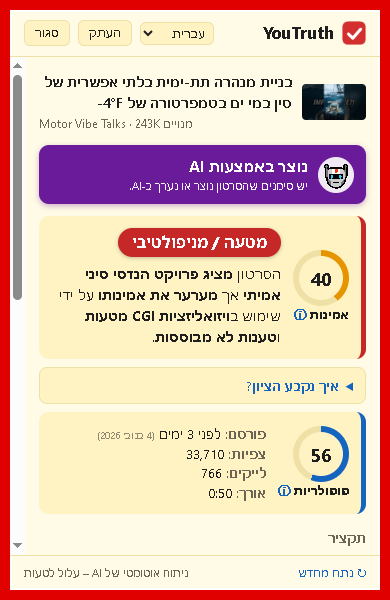

# YouTruth

תוסף Chrome שמנתח סרטוני YouTube בעזרת Google Gemini ומציג:

1. **אופי הסרטון** – חדשות מוסמכות / דיווח לא מאומת / דעה / חינוכי / בידור / סאטירה / שיווקי / מטעה / פייק, עם ציון אמינות 0–100 ודגלים אדומים.
2. **תקציר** ונקודות עיקריות.
3. **נתוני הסרטון** – תאריך פרסום (ולפני כמה זמן), צפיות, לייקים, אורך ומספר מנויים בערוץ. הנתונים נשלפים מדף הסרטון ב-YouTube ומתרעננים בכל פתיחה של החלון.

**שפות:** עברית, רומנית (Română) ואנגלית – גם הממשק וגם הניתוח שמחזיר Gemini. בוחרים שפה בהגדרות או ישירות מהתפריט בחלון התוסף. בהתקנה ראשונה השפה נקבעת לפי שפת הדפדפן (ברירת מחדל: אנגלית).

Gemini "צופה" בסרטון עצמו (וידאו + אודיו) דרך כתובת ה-YouTube. אם הסרטון לא נגיש (פרטי, מוגבל גיל, שידור חי, ארוך מדי) – מתבצע ניתוח חלקי לפי הכותרת והערוץ, ומוצגת הודעה על כך.

## התקנה

1. צור מפתח ב-https://aistudio.google.com/api-keys
2. ב-Chrome פתח `chrome://extensions`, הפעל **Developer mode**.
3. לחץ **Load unpacked** ובחר את התיקייה `YouTruth`.
4. דף ההגדרות ייפתח אוטומטית – הדבק את המפתח, לחץ "בדוק מפתח" ואז "שמור".

## שימוש

- היכנס לסרטון ב-YouTube (כולל Shorts).
- במצב "ניתוח אוטומטי" (ברירת מחדל) הניתוח מתחיל מיד וציון האמינות מופיע על האייקון (ירוק / צהוב / אדום).
- **ב-Shorts** הניתוח מתחיל רק אחרי השהיה (ברירת מחדל 4 שניות, `0` = מיד), כדי לא לבזבז בקשות על סרטונים שרק גוללים דרכם. הניתוח לא מתחיל בטאב שאינו פעיל.
- **מצב האייקון:** ⏳ = ממתין לפני ניתוח · שלוש נקודות זזות = Gemini מנתח · ? = לא מנותח אוטומטית (לחץ על האייקון) · מספר = ציון האמינות · ! = שגיאה.
- לחיצה על האייקון מציגה את הניתוח המלא. "נתח מחדש" מריץ שוב.
- אם יש סימנים שהסרטון נוצר או נערך ב-AI, מוצג בראש החלון פס סגול בולט.
- **העתק:** כפתור בראש החלון מעתיק ללוח טקסט מוכן להדבקה בוואטסאפ, עם הדגשות (`*טקסט*`): שם הסרטון, נושא/קטגוריה, מדד אמינות, תקציר, נקודות עיקריות (אם "הצג פרטים" פעיל), דגלים אדומים (אם יש) ובסוף הקישור.
- בהגדרות אפשר להסתיר את הנקודות העיקריות ("הצג פרטים").
- תוצאות נשמרות מקומית (ברירת מחדל: 60 הניתוחים האחרונים; אפשר לשנות בהגדרות, בין 10 ל-300) לכל סרטון ושפה בנפרד, כך שחזרה לסרטון לא צורכת בקשה נוספת. מעבר לשפה שעוד לא נותחה עבור הסרטון = בקשה חדשה.

## הערות

- כל ניתוח = בקשה אחת ל-Gemini (שתיים אם יש נפילה לניתוח חלקי). אם המכסה מוגבלת – כבה את הניתוח האוטומטי בהגדרות.
- הניתוח משתמש ב-`mediaResolution: LOW` כדי לצמצם צריכת טוקנים בסרטונים ארוכים, וברזולוציה בינונית בסרטונים של עד 3 דקות (כדי לזהות טוב יותר תוכן שנוצר ב-AI).
- המפתח נשמר ב-`chrome.storage.local` (לא מסונכרן לחשבון Google) ונשלח רק ל-`generativelanguage.googleapis.com`.
- זהו ניתוח של AI ועלול לטעות – במיוחד באירועים שקרו אחרי תאריך הידע של המודל.

## קבצים

| קובץ | תפקיד |
|---|---|
| `manifest.json` | הגדרות התוסף (Manifest V3) |
| `shared.js` | שפות, מחרוזות ממשק (he/ro/en) והגדרות ברירת מחדל |
| `background.js` | זיהוי ניווט ב-YouTube, קריאה ל-Gemini, מטמון ואייקון מונפש (שעון חול / נקודות / ? / ציון) |
| `popup.html/css/js` | חלון התוצאה (RTL/LTR לפי השפה) + בורר שפה + כפתורי העתקה (לוואטסאפ) וסגירה |
| `options.html/js` | הגדרות: שפה, מפתח, מודל, ניתוח אוטומטי, השהיה ב-Shorts, הצגת פרטים |
